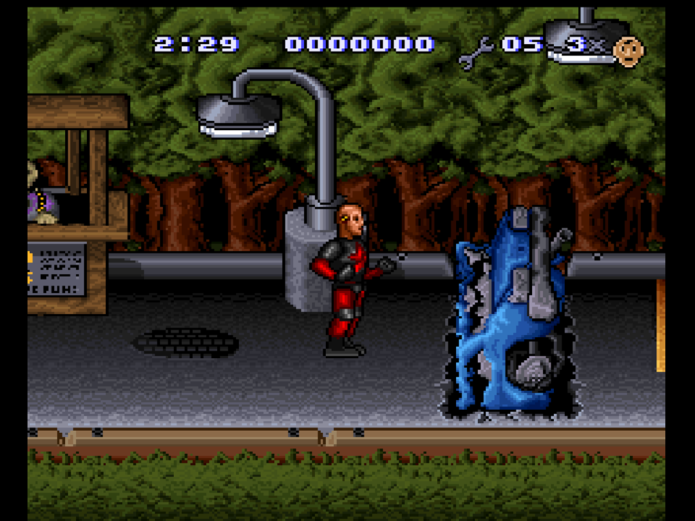

# The Incredible Crash Dummies Recompiled (SNES) — WORK IN PROGRESS

> **Shaders only work on the Vulkan and OpenGL renderers.**
>
> This project ships no game code or ROM data. You supply your own cartridge dump.

**Status: early WIP, no release yet.** Started Nov 1 2026 from the
[Demon's Crest SNESRecomp](https://github.com/rac08241988/DemonsCrestSNESRecomp)
v1.1.0 template on the [snesrecomp](https://github.com/magnopaz/snesrecomp)
framework. The Windows build boots to the title screen and into the first
level ("Dummy Parking") under wine; it has not been played through yet.



## What works so far

- ROM check: `Incredible Crash Dummies, The (USA)`, LoROM FastROM, 1 MB, no
  SRAM (the game uses passwords), header checksum valid.
- Recompiler runs on the ROM (`tools/regen.sh`). The seed is LLE-first:
  every routine still runs on the framework's interpreter tier; no
  ahead-of-time functions are promoted yet.
- Windows x64 build (MinGW cross-compile), boots to the title screen and
  gameplay.
- Options side panel from the template (Esc / F12 / pad Guide) with
  Crash Dummies colours (crash-test yellow, safety-orange edge): tabs Video,
  Display, Audio, Controls, Shaders, System; Apply button plus F5 / pad X or
  Start; keyboard / Xbox / PlayStation hint bar; Background input (default
  Off); 120 Hz motion option; live shader preview.
- No Widescreen option: this game does not support it (the Demon's Crest
  widescreen hooks were game-specific and were removed).

## Not done yet

- Playtesting all levels, AOT promotion of hot routines, save-state restore
  check, shader set check on Vulkan, setup exe / one-click builder and
  release zip, save import and `uninstall.bat` on real Windows.

## Controls & Shortcuts

These are the default bindings from the code and `config.ini` (`[KeyMap]`).
They are the template defaults; this WIP build has not re-verified each one. "View"
is the Xbox View/Back button, which is SNES Select.

| Action | Xbox controller | Keyboard |
|---|---|---|
| D-pad | D-pad | Arrow keys |
| SNES A / B / X / Y | B / A / Y / X | X / Z / S / A |
| SNES L / R | LB / RB | C / V |
| Start / Select | Menu (Start) / View (Select) | Enter / Right Shift |
| Options menu (pauses the game) | Guide | F12 or Esc |
| Menu: move / change / accept / back | D-pad / Left-Right / A / B | Arrows / Left-Right / Enter or Space / Backspace or Esc |
| Menu: previous / next tab | LB / RB | Q / E (or Tab, PgUp / PgDn) |
| Menu: Apply | X or Start | F5 (or the Apply button) |
| Save-state browser | hold View (Select) + press RB | F11 |
| Save-state browser: load / save / back | B / Y / A | X / S / Esc or Backspace (1-9, 0, -, = pick a slot) |
| Quick load / quick save slot 1-10 | - | F1-F10 / Shift+F1-F10 |
| Rewind | hold View (Select) + press R3 | Shift+F12 |
| Rewind: scrub / resume here / cancel | Left-Right / B / A | Left-Right / Enter or Space / Esc |
| Open the launcher | hold View (Select) + press L3 | Ctrl+L |
| Fullscreen | - | Alt+Enter |
| Reset | - | Ctrl+R |
| Pause / pause dimmed | - | Shift+P / P |
| Turbo (fast-forward) | - | Tab |
| Window bigger / smaller | - | Ctrl+Up / Ctrl+Down |
| Volume up / down | - | Keypad + / Keypad - |
| Show performance / toggle renderer | - | F / R |
| Start/stop a recording | - | Alt+R |

The default pad map is positional: SNES B = Xbox A, SNES Y = Xbox X,
SNES A = Xbox B, SNES X = Xbox Y. The Options menu uses Xbox A to accept and
Xbox B to go back, and reads the pad only while it is open; gameplay input is
never re-routed.

## Build (from Linux, Windows exe)

```sh
git clone https://github.com/rac08241988/IncredibleCrashDummies-SNESRecomp
cd IncredibleCrashDummies-SNESRecomp
scripts/setup.sh --rom "/path/to/Incredible Crash Dummies, The (USA).sfc"
cmake -S . -B build-win -G Ninja -DCMAKE_BUILD_TYPE=Release \
      -DCMAKE_TOOLCHAIN_FILE=$PWD/cmake/mingw-w64.cmake
cmake --build build-win -j
```

## ROM identity

| | |
|---|---|
| File | `Incredible Crash Dummies, The (USA).sfc` |
| Header title | `INCRED. CRASH DUMMIES` |
| Mapping | LoROM (FastROM), 1 MB, no SRAM |
| CRC32 | `0b6209ba` |
| SHA-1 | `8fb4dc371c0e44fe362b23b5fec464288e3cc5ec` |
| SHA-256 | `0415adfe80977485f84cdffaaa79f18c91c004c7dba202b4cf9a94eb11adeada` |

A 512-byte copier header is stripped before the check.

## Tested On

The project owner's PC:

- CPU: AMD Ryzen 7 5800X3D (8 cores / 16 threads, 96 MB 3D V-Cache)
- GPU: NVIDIA GeForce RTX 3070 Ti (8 GB GDDR6X)
- RAM: 32 GB dual-channel
- Storage: M.2 NVMe SSD
- OS: Windows and AtlasOS
- Renderers tested: Vulkan and OpenGL

(WIP: so far only tested under wine on Linux.)

## License

This project's own source is under the MIT license in [`LICENSE`](LICENSE).
The framework and launcher carry their own terms — see `snesrecomp/LICENSE`,
`snesrecomp/THIRD_PARTY_ATTRIBUTION.md` and `recomp-ui/LICENSE`. Neither
covers the game data, which is not distributed here.
